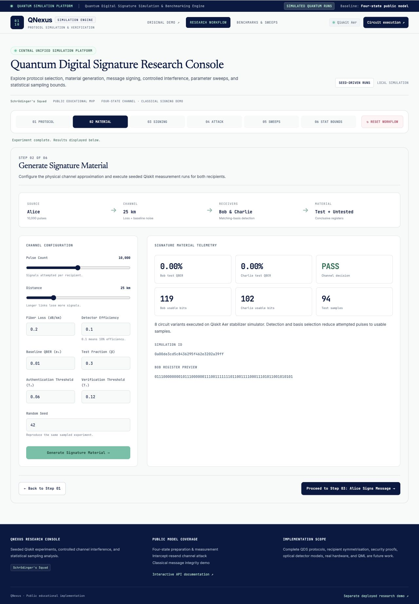

# QNexus

**Team: Schrödinger's Squad**

QNexus explores how quantum signature-related channel behaviour changes when communication is noisy or an attacker interferes. This repository provides a small, runnable experiment lab with actual Qiskit circuit execution, a browser dashboard, and reproducible measurement outputs.

**Scope:** This is an independent public educational MVP. It is not the source of the separate [deployed research console](https://quantumdigitalsignature.vercel.app/). The code implements a BB84-inspired four-state channel and an explicitly classical message-signing wrapper. It does **not** implement the complete Practical QDS protocol or establish QDS security. Confidential deployed source files are not included.

## What works

| Feature | Public implementation |
| --- | --- |
| Quantum circuits | Prepare Z/X states and measure them on Qiskit Aer |
| Material generation | Seeded losses, independent Bob/Charlie channels, basis sifting, test and untested registers |
| Message demonstration | HMAC-SHA256 signs a message and experiment ID; edits fail the integrity check |
| Recipient checks | Illustrative mismatch thresholds on unused measurement material |
| Intercept-resend attack | Eve measures in a random basis and forwards the collapsed state |
| Parameter sweeps | Up to 21 intensities with measured and expected QBER |
| Sampling analysis | Two-sided Hoeffding deviation bound with explicit assumptions |
| Circuit execution view | Actual circuit, shot counts, and measurement outcomes |
| Export | JSON experiment reports and sweep data |

## Setup and run

Use **Python 3.12**. IBM Quantum credentials and quantum hardware are not required.

```bash
git clone https://github.com/ManasRoy21/Qnexus.git
cd Qnexus
python3 -m venv .venv
source .venv/bin/activate
python -m pip install -r requirements.txt
python -m uvicorn qnexus.app:app --host 127.0.0.1 --port 8000
```

On Windows, create the environment with `py -3.12 -m venv .venv` and activate it with `.venv\Scripts\Activate.ps1` in PowerShell. Then run the same pip and uvicorn commands.

Open **http://127.0.0.1:8000/**. API documentation is at **http://127.0.0.1:8000/docs**. To reproduce all dependency versions used during validation, install `requirements-lock.txt` instead of `requirements.txt`.

The dashboard follows the original console's light navy-and-mint design, serif headings, and six numbered stages. **Reset Workflow** clears local UI state; next/back buttons navigate the stages. **Circuit execution** is available separately in the header. The dashboard has system-font fallbacks if optional Google Fonts are unavailable. It is intended for local demonstration. Sessions live in memory and expire on restart or after 100 generated experiments.

## Quick demo

1. Select **Four-State Channel** in Protocol, then proceed to **02 Material**. Leave 10,000 pulses and seed 42; click **Generate Signature Material**.
2. Open **Signing**, sign the sample message, then verify it. Change the text and verify again to demonstrate tampering detection.
3. Open **Attack** and run full intercept-resend. Compare the error rate and decision with the baseline.
4. Open **Sweeps** and run intensities 0–1 in steps of 0.1. Examine the measured errors and model expectation.
5. Open **Sampling bounds**. A bound of 1 is uninformative, not proof of security.
6. Click **Circuit execution** in the header and run the 1,024-shot example. The circuit and actual counts appear.
7. Download the JSON experiment report.

For an ideal baseline, use distance 0, detector efficiency 1, and baseline QBER 0. See [the walkthrough](docs/DEMO.md).

## Terminal demo and tests

```bash
python -m qnexus.cli
python -m pip install -r requirements-dev.txt
python -m pytest -q
```

The CLI executes Aer circuits and writes `examples/generated/demo.json`. The checked-in [sample run](examples/demo-results.json) uses 10,000 pulses, seed 42, zero distance, perfect detection, and zero baseline noise:

| Experiment | Observed pooled test QBER |
| --- | --- |
| Clean channel | 0.00% |
| Full random-basis intercept-resend | 24.55% |

The changed-message integrity check returned `false`. These are simulation results for this public model, not measured performance of the deployed app or real hardware. Tests cover state preparation, attack disturbance, reproducibility, message tampering, insufficient samples, sampling bounds, validation, and the API workflow.

## Source and architecture

```text
web/                  HTML/CSS/JavaScript dashboard
qnexus/app.py         FastAPI endpoints and in-memory experiments
qnexus/models.py      Validated inputs and bounded experiment sizes
qnexus/circuits.py    Executable preparation, Eve, and measurement circuits
qnexus/simulation.py  Losses, basis sifting, Aer sampling, and QBER
qnexus/security.py    Classical integrity wrapper and Hoeffding calculation
qnexus/cli.py         Reproducible command-line demonstration
tests/                Physics, integrity, and API workflow checks
examples/             Actual sample output
docs/                 Implementation details and demo guide
```

See [implementation details](docs/IMPLEMENTATION.md) for formulas, the API, and model boundaries.



## Boundaries and roadmap

This MVP does not include optical coherent-state detection, recipient symmetrisation, complete multi-bit QDS signing, forging/repudiation security proofs, hardware execution, or ML/QML. Bob, Charlie, and the signer share one local process. Seeded random numbers and demo key derivation are for reproducible teaching, not real security applications.

Next steps are to implement and validate a specified QDS protocol against its published equations, establish finite-size security estimates, compare controlled attack models, and investigate hardware-aware noise. Quantum advantage and protocol-level security are not claimed.

## References and sources

- [IBM: simulation with Qiskit Aer](https://quantum.cloud.ibm.com/docs/en/guides/simulate-with-qiskit-aer)
- [Qiskit AerSimulator API](https://qiskit.github.io/qiskit-aer/stubs/qiskit_aer.AerSimulator.html)
- [Qiskit depolarizing-error model](https://qiskit.github.io/qiskit-aer/stubs/qiskit_aer.noise.depolarizing_error.html)
- [Dunjko, Wallden and Andersson: Quantum Digital Signatures without quantum memory](https://arxiv.org/abs/1309.1375), background motivation; this repository is not an implementation of that paper.
